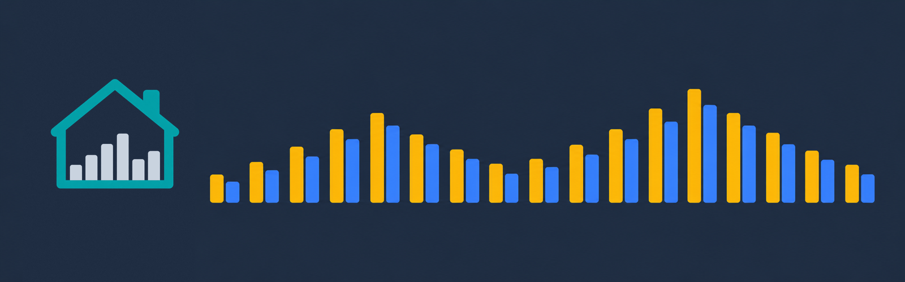
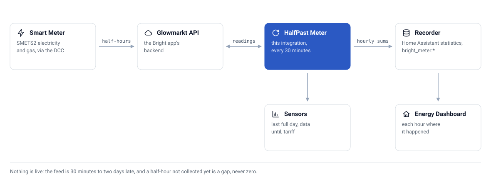

<div align="center">



# 📊 HalfPast Meter

**Put your UK smart meter's half-hourly electricity and gas into the Home Assistant Energy dashboard, whoever your supplier is**


[](https://github.com/CaputoDavide93/HalfPast-Meter/actions/workflows/tests.yaml)

</div>

---

> **Private on purpose.** HalfPast Meter has run against one live Bright account, but
> several behaviours are still unproven (see [what is tested](#-tested-and-unverified)).
> Until they are, the repository stays private, so HACS cannot install it and
> `scripts/install-on-ha.sh` ships it instead. The README, diagrams and docs use demo
> data only, so the repository can go public without a rewrite; the steps are in
> [docs/development.md](docs/development.md#going-public).

## 💡 Why it exists

You have a smart meter, and Bright (Hildebrand Glow's free app) shows your usage by the
half hour. Home Assistant's Energy dashboard cannot see any of it, and a sensor that
records a reading when Home Assistant happens to poll puts late data in the wrong hour.
The meter's data reaches Glowmarkt 30 minutes to two days after the fact.

HalfPast Meter imports the readings as hourly external statistics, each one placed at the
hour it was measured, so the Energy dashboard shows what the meter measured. It works
with any supplier, because Bright reads the meter through the DCC, not through the
supplier.

| | HalfPast Meter | A sensor integration | Typing readings in by hand |
|---|---|---|---|
| Late readings land in the right hour | Yes, the last week is re-read every pass | Depends on the integration; a polled sensor records them when it is read | Only if you backdate each one |
| Gaps | Left as gaps, never drawn as zero | Usually the last value, or zero | Whatever you type |
| History on first setup | Up to a year (1 to 3650 days) | Usually none | Whatever you type |
| Cost and tariff | Cost statistics, plus unit rate and standing charge from the meter | Depends on the integration | Your own sums |
| Live power | No | Only with a local device | No |
| Works while the repository is private | Yes, installed over SSH | Yes | Yes |

The trade-off: nothing here is live. The feed is half-hourly and arrives late.

---

## 🚀 Install in 3 steps

You need Home Assistant 2026.9 or newer, a Bright account that already shows your usage
(iOS or Android app, free), and SSH to your Home Assistant host (the SSH add-on, key login).

1. **Clone and point the script at your host.**

   ```bash
   git clone https://github.com/CaputoDavide93/HalfPast-Meter && cd HalfPast-Meter
   cp .env.example .env        # set HA_SSH_TARGET to your host's SSH login
   ```

2. **Ship it.** `scripts/install-on-ha.sh --restart` copies the committed component and runs
   `ha core restart`. (Or copy `custom_components/bright_meter/` into `config/custom_components/` and restart.)
3. **Add it.** **Settings, Devices and services, Add integration, HalfPast Meter.** Four pages: sign in, your meters, how much history, the statistics to pick for the Energy dashboard.

If another integration already feeds the same meters, remove it from the dashboard first, or
the energy is counted twice. Details and checks: [docs/setup.md](docs/setup.md).

---

## ✨ Features

| | Feature | What it does |
|---|---|---|
| 📈 | Energy dashboard history | Imports electricity, gas and their cost as hourly external statistics, each hour placed where it happened, however late the reading lands |
| 🕳️ | Gaps stay gaps | Asks Glowmarkt to mark uncollected half-hours (`nulls=1`) and stops at its newest reading (`last-time`): a missing hour gets no row, and a real zero is imported at once. An hour stored earlier that later comes back missing is kept flat (zero that hour) rather than deleted |
| 🔁 | Late data repaired | Re-reads the last week on every pass. Every chunk is read and checked before anything is written, then the rewrite goes in as one batch, so revised readings replace what was stored and the running total does not step backwards |
| 🔀 | Energy dashboard switch | One tick replaces only the grid and gas sources with HalfPast Meter's, leaves a fuel without data where it is, and keeps the old setup for a one-click restore |
| 🗓️ | Last full day | Yesterday's total once every hour of it is in, built from local midnights so the 23- and 25-hour clock-change days come out right |
| 🏷️ | Meter tariff | The unit rate and standing charge the meter itself holds, per fuel, so you can see whether a new supplier's rates have reached it |
| 🪪 | Stable statistic ids | Each meter stream keeps the id it was first given, so adding a site or a second account never renames, or writes into, an existing history |
| 🧾 | First import | Up to a year of history on setup (configurable to ten), in 30-day chunks |
| 🔐 | Reauthentication | A password changed in the Bright app asks to be re-entered instead of failing silently |
| 🩺 | Diagnostics | How far each stream reaches, its last full day and tariff, with no email, password, meter ids or site name |

Works with **Bright**, Hildebrand Glow's free smart-meter app, through Hildebrand's Glowmarkt API. This is an independent project, not affiliated with or endorsed by Hildebrand or Glow.

Nothing here is live. The DCC feed is half-hourly and 30 minutes to two days late, and Bright has no meter register for DCC-only accounts. Live power needs a Glow display or CAD on local MQTT, which this integration does not read.

---

## 🗺️ Architecture

<picture>
  <source media="(prefers-color-scheme: dark)" srcset="docs/assets/architecture-dark.svg">
  
</picture>

Every 30 minutes the integration asks Glowmarkt how far each stream's data reaches, nudges it to fetch new readings from the DCC (at most every two hours), and reads the meter's tariff every six hours. A background import then reads hourly readings from a week before the newest stored hour (or the whole configured history on the first run) up to `last-time`, and writes them with `async_add_external_statistics`.

---

## 🧪 Tested and unverified

| Area | Status |
|---|---|
| Statistics import, gaps, late data, clock-change days, tariff fallback, reauth, diagnostics | Tested: pytest suite against a real recorder, Home Assistant 2026.9.4, Python 3.14 |
| Sign-in, streams and import on a live Bright account | Run on one account; no wider coverage |
| Home Assistant HACS and Hassfest validation | Hassfest runs in CI; the HACS action runs only once the repository is public (it cannot validate a private one) |
| DCC catch-up request limit of two hours | Unverified: published folklore, the integration keeps to it |
| Which half-hour carries the standing charge in the cost stream | Unverified |
| The tariff payload's real shape | Unverified: both documented shapes are parsed |
| Gas returned in m³ instead of kWh | Unverified |
| Accounts with only DCC data, or several sites | Unverified |

---

## 📚 Documentation

| Guide | What it covers |
|---|---|
| [Setup](docs/setup.md) | The Bright app, installing, the four setup pages, checking it worked |
| [Energy dashboard](docs/energy-dashboard.md) | Which statistic goes where, and moving over from another integration |
| [FAQ](docs/faq.md) | Short answers: suppliers, live power, privacy, why it is private |
| [Statistics and sensors](docs/entities.md) | Every statistic and sensor, generated from the code |
| [How it works](docs/how-it-works.md) | One 30-minute pass, and the rules that keep the history right |
| [Troubleshooting](docs/troubleshooting.md) | Symptoms first, then diagnostics and debug logging |
| [Glowmarkt API](docs/glowmarkt-api.md) | The calls, units and quirks, what is unverified, and the prior art |
| [Development](docs/development.md) | Checks, layout, rules, releases, going public |

---

## ⚙️ Configuration

The guided setup asks for the Bright **email** and **password**, shows the meters it found, and with more than one site lets you choose which to import. It stops with a clear message if the details are rejected, if Glowmarkt cannot be reached, or if the account has no electricity or gas meter yet.

| Option | Default | What it does |
|---|---|---|
| How much history to import | 365 days (1 to 3650) | How far back the first import reaches. Raising it clears the imported history and rebuilds it from the new depth; lowering it keeps what is already imported |

---

## 📖 Usage

### Statistics

For the Energy dashboard. An export statistic appears only if the account has an export stream.

<!-- AUTOGEN:statistics -->
| Statistic | Unit | Stream |
|---|---|---|
| `bright_meter:electricity_consumption` | kWh | `electricity.consumption` |
| `bright_meter:electricity_consumption_cost` | GBP | `electricity.consumption.cost` |
| `bright_meter:electricity_export` | kWh | `electricity.export` |
| `bright_meter:gas_consumption` | kWh | `gas.consumption` |
| `bright_meter:gas_consumption_cost` | GBP | `gas.consumption.cost` |
<!-- /AUTOGEN:statistics -->

### Sensors

One device per Bright site. None of the sensors has a `state_class`, on purpose: the statistics above are the history, and a second series built from the sensors would double-count.

<!-- AUTOGEN:entities -->
| Sensor | Unit | What it is |
|---|---|---|
| Electricity last full day | kWh | The last whole local day; `day` attribute says which |
| Electricity data until | timestamp | End of the newest whole hour Glowmarkt holds (diagnostic) |
| Electricity unit rate | GBP/kWh | Unit rate the meter holds |
| Electricity standing charge | GBP/d | Standing charge the meter holds |
| Electricity cost last full day | GBP | The last whole local day; `day` attribute says which |
| Export last full day | kWh | The last whole local day; `day` attribute says which |
| Export data until | timestamp | End of the newest whole hour Glowmarkt holds (diagnostic) |
| Gas last full day | kWh | The last whole local day; `day` attribute says which |
| Gas data until | timestamp | End of the newest whole hour Glowmarkt holds (diagnostic) |
| Gas unit rate | GBP/kWh | Unit rate the meter holds |
| Gas standing charge | GBP/d | Standing charge the meter holds |
| Gas cost last full day | GBP | The last whole local day; `day` attribute says which |
<!-- /AUTOGEN:entities -->

---

## 🛠️ Troubleshooting

<details>
<summary><b>The numbers stop at yesterday, or earlier</b></summary>

That is the feed, not a fault. Check the **data until** sensors: they show the end of the newest whole hour Glowmarkt holds. Opening the Bright app also asks Glowmarkt to fetch new readings.

</details>

<details>
<summary><b>The cost doesn't match the bill</b></summary>

The cost statistics are Glowmarkt's own figures, converted from pence. They include the daily standing charge and use the rates the meter holds, with whatever VAT Glowmarkt applies. Treat them as an estimate, not a bill.

</details>

<details>
<summary><b>The tariff sensors are unknown</b></summary>

The supplier has not sent a rate to the meter over the DCC, or has not yet after a switch. The integration asks the consumption stream first and the cost stream second; if neither answers, the sensor stays unknown rather than showing zero.

</details>

---

## 📁 Repo structure

```text
HalfPast-Meter/
├── custom_components/
│   └── bright_meter/        # 🧩 the integration: API client, coordinator, sensors, flows, brand icons
├── tests/                   # 🧪 pytest against Home Assistant 2026.9.4
├── scripts/
│   ├── check-login.py       # 🔑 test a Bright login as the integration signs in
│   └── install-on-ha.sh     # 📦 ship the committed component to an HA host over SSH
├── tools/
│   ├── gen_diagram.py       # 🗺️ draws the diagrams in docs/assets/
│   └── gen_docs.py          # 🤖 the statistics and sensor tables (README, docs/entities.md)
├── docs/                    # 📚 setup, FAQ, energy dashboard, entities, how it works, API, development
│   └── assets/              # 🖼️ banner, brand tile and diagrams, light and dark
├── .github/                 # 🤖 tests, Hassfest and HACS workflows, dependabot
├── llms.txt                 # 🤖 the project in one plain-text page
├── Makefile                 # 🔧 venv, check, test, lint, diagram, install
├── .env.example             # ⚙️ the install script's SSH target
├── hacs.json  pyproject.toml  pytest.ini  requirements_test.txt
└── AGENTS.md  CLAUDE.md  CHANGELOG.md  LICENSE  SECURITY.md
```

---

## 🧪 Testing

```bash
make venv     # Home Assistant 2026.9.4 test environment, built with uv
make check    # ruff, pytest, diagrams and README tables current
```

The tests run against a real recorder: the statistics import, gaps and late data, clock-change days, the tariff fallback, reauth and diagnostics.

---

## 📦 Deployment

`scripts/install-on-ha.sh` ships `HEAD`, never the working tree, and refuses if the component has uncommitted changes. It unpacks beside the installed copy and swaps it in, so a failed transfer leaves the old version running. Pass `--restart` to run `ha core restart` afterwards.

---

## 🔒 Security

The Bright credentials stay in the Home Assistant config entry and go only to `api.glowmarkt.com`. See [SECURITY.md](SECURITY.md).

---

## 📄 License

MIT, see [LICENSE](LICENSE). Started from [existentia/hildebrand-glow-ha](https://github.com/existentia/hildebrand-glow-ha) v0.1.2 by Neil J, also MIT; its licence is kept in the component.

Hildebrand, Glow, Glowmarkt and Bright are Hildebrand's names, used here only to say what this integration works with.

---

<p align="center"><sub>Made with ❤️ by <a href="https://github.com/CaputoDavide93">Davide Caputo</a></sub></p>
