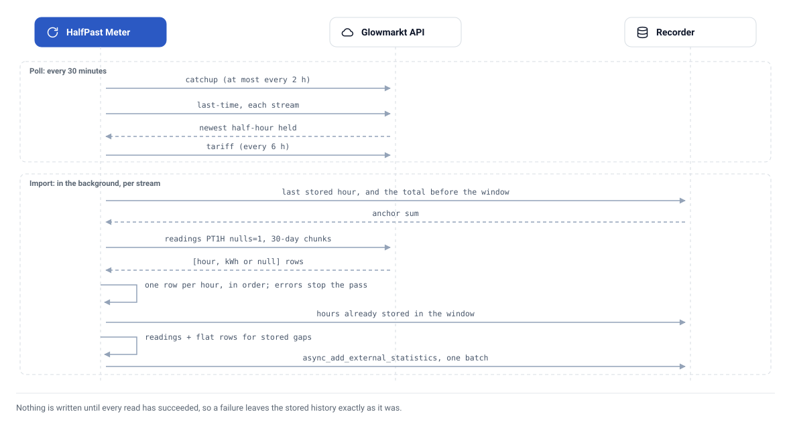

# ⚙️ How it works

What the integration does every 30 minutes, and the rules that keep the Energy
dashboard's history right however late, repeated or broken the data is.

## The data

Your smart meter records consumption every half-hour. The DCC collects those
reads, and Hildebrand Glow's Glowmarkt platform (the backend of the Bright app)
fetches them for your account. Two facts follow:

- **Nothing is live.** A half-hour usually reaches Glowmarkt 30 minutes to a few
  hours late, sometimes a day or two, and past values can be revised.
- **Glowmarkt fetches only when asked.** Something has to request a *catch-up*
  from the DCC; the Bright app does it when opened, and this integration does it
  at most every two hours.

Live power and the meter's register (its running total) need Glow hardware on
local MQTT, which this integration does not read.

## One pass

<picture>
  <source media="(prefers-color-scheme: dark)" srcset="assets/import-pass-dark.svg">
  
</picture>

**The poll** (every 30 minutes, the coordinator's update):

1. Request a DCC catch-up for each stream, at most every 2 hours 5 minutes.
2. Ask each stream's `last-time`: the start of the newest half-hour held. These
   calls are also what surface a rejected password or an unreachable API.
3. Read each fuel's tariff, every 6 hours.
4. Start the import in the background, so a deep first import never delays the
   poll.

**The import** (per stream; each step below is pinned by a test):

1. **The edge.** An hour is complete when its second half-hour has arrived:
   `data_until` is the hour after `last-time − 30 min`, never later than the
   hour in progress.
2. **The window.** From the newest stored hour, or a week before now, whichever
   is earlier: late and revised readings inside that week replace what was
   stored. On the first run, or after the history depth is raised, the window
   is the whole configured history.
3. **The anchor.** The running total stored just before the window, searched in
   widening steps (30, 400, then 3,680 days) so a long gap never restarts the
   total at zero.
4. **The reads.** Hourly readings (`PT1H`, `nulls=1`, `offset=0`) in 30-day
   chunks, 0.2 s apart, each allowed 90 s. A chunk that times out is split in
   half and each half read on its own, down to a single day. The sensors' own week is always read too, whatever the
   depth.
5. **The checks.** Every row on the hour, one reading per hour, in time order.
   A repeated identical hour is kept once; two different readings for one hour,
   an error answered with HTTP 200, a malformed row or a non-finite value fail
   the pass, and the next pass tries again.
6. **The rows.** For each hour of the window, in order:

   | The hour | Row written |
   |---|---|
   | has a reading (zero included) | the reading, and the running total |
   | is a gap (`null`) or past the edge, and nothing was stored | none |
   | is a gap or past the edge, but a row was stored before | zero, total carried forward |

7. **The write.** Only once every read has succeeded: one
   `async_add_external_statistics` batch per stream. After a depth increase
   the old series is cleared first, on the recorder's queue ahead of the batch.

A failure anywhere before step 7 leaves the stored history exactly as it was.

## Statistic ids

Each meter stream's history lives under one external statistic id, so the id
must never change. It is assigned the first time the stream is seen and stored
in `.storage/bright_meter.statistic_ids`:

- the first stream of a kind gets the readable id,
  `bright_meter:electricity_consumption`;
- a later stream of the same kind (another site, another account) gets a
  suffix from its Glowmarkt resource id: `bright_meter:electricity_consumption_1a2b3c4d`.

Site names never go into an id: they are often addresses, and ids appear in
diagnostics.

## Days, clocks and costs

- **Local days** are built from local midnights, so the "last full day" sensors
  are right on the 23- and 25-hour clock-change days. A day with any missing
  hour is skipped rather than reported short.
- **Everything is fetched in UTC** (`offset=0`). Glowmarkt's handling of a
  non-zero offset is not documented well enough to rely on.
- **Cost** is Glowmarkt's own cost stream, converted from pence to pounds. It
  includes the daily standing charge, priced at the rates the meter holds, with
  whatever VAT Glowmarkt applies. Treat it as an estimate, not a bill.

## Lifecycle

- **Reauthentication:** a rejected password, in the poll or in the background
  import, starts Home Assistant's re-enter-your-password flow.
- **Unloading** waits up to 30 seconds for a running import, without cancelling
  it; an import still running then is left to finish on its own.
- **Stopping Home Assistant:** an import stops between chunks, before writing.
- **A failed import** never marks the integration as updated successfully.
