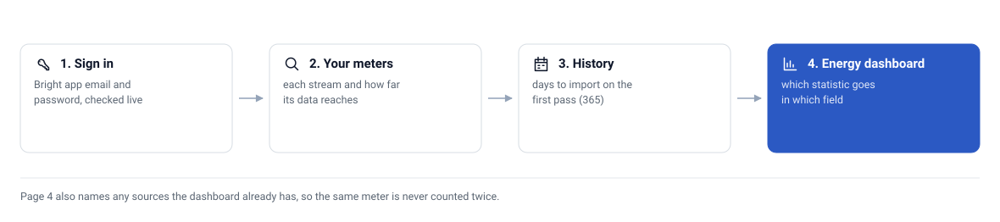

# 🚀 Setup

From nothing to the Energy dashboard, in order. Allow about twenty minutes of
your time, plus a day or two for Bright to start receiving your meter's data
if you are new to it.

<picture>
  <source media="(prefers-color-scheme: dark)" srcset="assets/setup-flow-dark.svg">
  
</picture>

## 1. The Bright app

Bright is Hildebrand Glow's free smart-meter app (iOS and Android). It reads
your SMETS2 meter through the DCC, the national smart-meter network, so it
works whoever your energy supplier is. This integration reads the same data
through the same account, and is not affiliated with Hildebrand or Glow.

1. Install **Bright** and create an account.
2. Add your meter: Bright asks for your address and confirms the meter point.
3. Allow it to access your meter's data. This is a consent the DCC records.
4. Wait until the app shows your usage. For a new account that can take a day
   or two; until then the integration has nothing to import.

Use a password you are happy to store in Home Assistant: the integration keeps
it in its config entry to sign in again when its session expires (every 7
days).

## 2. Install the integration

**With HACS**, once the repository is public (HACS installs only public
repositories): **HACS → ⋮ → Custom repositories**, add
`https://github.com/CaputoDavide93/HalfPast-Meter` with the category
**Integration**, install **HalfPast Meter**, then restart Home Assistant.
HACS offers each GitHub release, and notifies you of new ones.

**While the repository is private**, install it one of these two ways.

**From a clone, over SSH** (needs the SSH add-on, with your public key):

```bash
cp .env.example .env               # set HA_SSH_TARGET, e.g. root@homeassistant.local
scripts/install-on-ha.sh --restart
```

The script ships the committed version only, refuses if the component has
uncommitted changes, and swaps the new copy in so a failed transfer leaves the
old one running. `--restart` runs `ha core restart`; leave it off to restart at
a time that suits the house.

**By hand:** copy `custom_components/bright_meter/` into Home Assistant's
`config/custom_components/`, then restart Home Assistant.

## 3. Add it: the guided setup

**Settings → Devices & services → Add integration → HalfPast Meter.**

| Page | What you do | What it shows |
|---|---|---|
| **Sign in to Bright** | Enter the Bright app's email and password | An error if they are rejected, Bright cannot be reached, or the account has no electricity or gas meter yet |
| **Your meters** | With more than one site, untick any you do not want | Every electricity, gas and export stream, and how far its data reaches in local time, or *no readings yet* |
| **How much history** | Choose the days to import on the first pass (default 365) | What re-reading the last week means |
| **Energy dashboard** | Note the statistics, then **Submit** | The exact statistic for each dashboard field, and any sources the dashboard already has |

After **Submit** the entry is created and the history starts importing in the
background. A year of data is 13 requests per stream, 0.2 s apart, and takes a
minute or two.

## 4. The Energy dashboard

Follow page 4, or [energy-dashboard.md](energy-dashboard.md) for the detail.
The short version: remove any other source for the same meters first, then
choose the `bright_meter:` statistics.

## 5. Check it worked

- **Settings → Devices & services → HalfPast Meter** shows one device per
  site.
- The **data until** sensors show a time within the last day or so.
- **Developer tools → Statistics** lists the `bright_meter:` statistics.
- The Energy dashboard shows bars for past days. Today stays empty: readings
  arrive 30 minutes to two days late.

If any of that is missing, see [troubleshooting.md](troubleshooting.md).

## Changing things later

- **History depth:** the integration's **Configure** button. Raising it clears
  the imported history and rebuilds it from the new depth; lowering it keeps
  what is already there.
- **A new password:** Home Assistant asks for it on its own when Bright rejects
  the old one.
- **Sites:** remove the integration and add it again, choosing differently.
  Statistic ids are kept per meter, so the history is re-imported, up to the
  depth you choose, into the same statistics the dashboard already uses.
